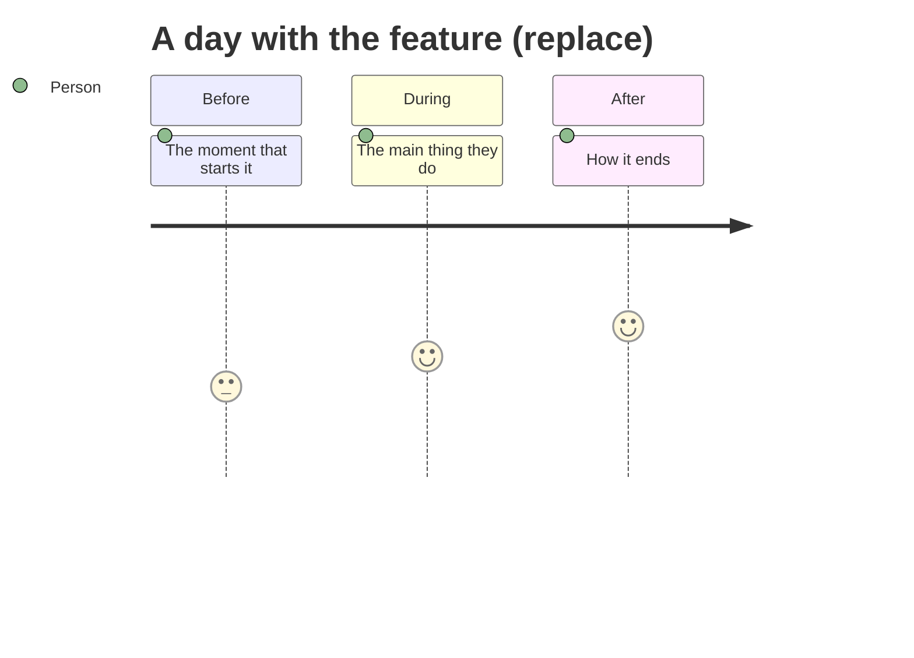

# [FILL: epic name] — the narrative

> **Who fills:** Vesper, at the UX stage's narrative pass (`docs/workflows/stages/ux.md` §4), interviewing the operator in numbered rounds; Gloss on the words.
> **When:** first at the UX level, before the intent pass, only when the operator chose narrative-first. Never required.
> **Lives at:** `specs/<app>/epics/<EPIC>-<slug>/ux/narrative.md`; past about 4,000 tokens, split into `ux/narrative/<part>.md` (one part per area or per stretch of the day), with this file's opening sections in the first part.
> **What the check enforces:** `check-specs` caps each file at 4,000 tokens, requires `status` (`draft` or `approved`) and refuses a `target:`: a narrative is never promoted, and a contract never cites it.
> **The reading test:** someone who has never seen the app can picture every screen, and the operator recognises the experience they described. **The fidelity check:** at the intent and handoff gates, Alembic traces every point here to the spec and lists anything lost. Delete this block when you fill it.

```yaml
status: draft # approved at the gate "narrative approved"
epic: <EPIC>
approved: # date
fed_by: [] # operator notes, research notes, the brief
```

Write for a person reading in the docs app: short paragraphs, one idea each, plain words. Name things the way the product names them. Example lines below are synthetic and in italics; replace or delete them.

## The moment and the feeling

Who this is for, where they are, and what has just happened when they reach this. Then the feeling the experience should leave, in one or two sentences, and the feeling it must never cause. [FILL]

_Example: Rowan has finished work and is on the train home. The day was long. Opening the app should feel like putting a bag down, not like being handed a list._

## A day in the life

The whole experience in order, as it happens to one person on one ordinary day: what prompts each step, what they do, what they notice, how it feels. Prose first. A diagram is welcome when the order or the mood is easier to see than to read.

[FILL]



## Surfaces

One section per surface, in the order a person meets them. Copy the block below for each.

### [FILL: surface name]

**What you see.** Top to bottom at 390 wide (the phone), as a list, each element named by its `@syn/ui` component and the words on it. Add a line for 1440 only where the layout differs. Say which one thing is the primary action. [FILL]

_Example: a `Heading` reading "Evening"; a `Card` per block left in the day, each with its name and a `Checkbox`; a sticky `Button`, "Close the day", the primary action._

**What you do.** Each thing a person can do here, and what happens next, including where it takes them. [FILL]

**Why it matters.** What this surface is for in the person's day, and the feeling it carries forward. One short paragraph. [FILL]

**Stories.**

- A person who [FILL: situation] wants to [FILL: action] so that [FILL: outcome].

**Edge cases and states.** Every state a person can reach, and what they see in it. The base set is empty, loading, error, partial, offline and success; add the surface's own; mark one that cannot happen as not applicable, with the reason.

| State  | What the person sees | What they can do |
| ------ | -------------------- | ---------------- |
| empty  | [FILL]               |                  |
| loading |                     |                  |
| error  |                      |                  |
| partial |                     |                  |
| offline |                     |                  |
| success |                     |                  |

Then the edge cases that are not states: a long name, a first time, a return after a week away, a change made on another device. [FILL]

## What Paper will hold

The artboards the Design stage will draw, one line each, named `<surface> / <state> / <width> / <scheme>`, so the canvas starts from this list. Leave this out when the Design stage was not chosen. [FILL]

- **Variations:** [FILL: yes, with the axis to vary (layout, density, tone), or no, straight to one direction]
- **Pace:** [FILL: all at once, or screen by screen, in this order: …]

## Open questions

What the operator has not decided, each with a recommended answer, marked `[NEEDS DECISION]`, or `[NEEDS DECISION — BLOCKING]` when the spec could not be derived without it. [FILL]
