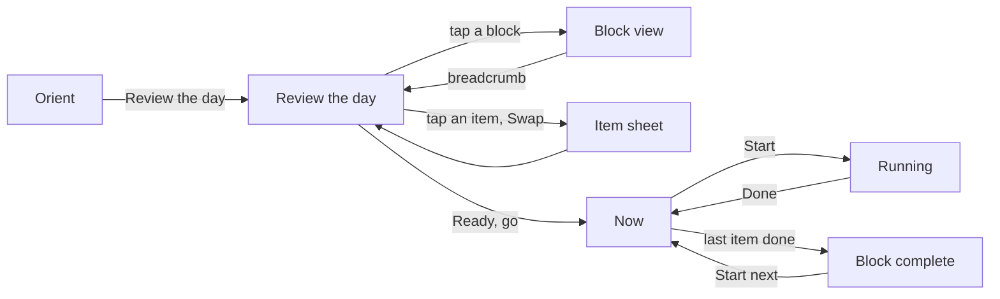

# Synapse as a daily tool — the narrative, part 1: the day

This is the day-to-day experience as a person reads it, before any of it is drawn or built. It comes in five parts: the day (this part), [setting your days](02-setting-your-days.md), [the morning](03-the-morning.md), [go mode](04-go-mode.md), and [what Paper will hold](05-paper-and-open.md). "Note n" points to a line in [Taylor's notes](../../../../../../docs/product/operator-notes/2026-10-09-day-to-day-use.md). "Round n" points to the interview answers, and "refinement n" to the first refinement round, both logged at the end of those notes.

Everything is drawn for one device: an iPhone at 402 × 874, light scheme first. There is no desktop (note 99).

## The moment and the feeling

It's just after seven. Taylor's phone has spent the night in the bathroom drawer, so getting it meant getting up (note 9). Bloom has locked out almost everything else, so Synapse is one of the only things on the phone that opens (note 12). The cold bath is filling. There are about ten minutes before getting into it: five for Orient, and the rest for looking at the day and meditating (amendment 1).

Opening Synapse should feel like opening the planner to this week's page: the day is already written in, in Taylor's own hand, and a pencil is within reach (notes 68–69). The recurring part of the week is written once; only the work and the week's events are written in each week (refinement 2). It greets the morning, settles the emotions (note 14), shows what the day holds, takes any change in a tap or two, and then says go. From there the day is a run of small, satisfying checks: "check, check, check" (note 65), with the dopamine of ticking things off (note 37) and nothing else on the screen.

It must never feel like a questionnaire. "What all things do you want to do in life" is exactly what this replaces (note 88). And it must never feel like a clock telling Taylor off. Running over shows how long, never in red and never with an alarm (note 62).

## Words this narrative uses

- **Block.** A named stretch of the day with a kind, an icon and a colour, holding a checklist. The kinds are Wellness, Training, Work, Break and Evening. Blocks are set first, and their items go inside them (notes 85, 87). Physio is a Training block (refinement 5). A stretch break is a small Training block, a walk is a small Wellness block, and a Break can be left empty, so that it is an actual break (refinement 8).
- **Checklist block.** A block whose items have no times, just an order: dragged into place, checked in any order. Made for a looser day like Sunday (refinement 10).
- **Transition.** A slim in-between: a drive, making breakfast. It can sit between two blocks, or inside one without leaving it ("drive to the gym" inside Wellness, note 57). A **meal** is a transition marked as a meal (note 92, round 5).
- **Item.** One line on a checklist, with an emoji or an icon, a name and a planned length (note 54).
- **Orient.** A locked block for the first five minutes after waking. It can't be removed (note 86).
- **Usual week.** Each weekday's default, Monday to Sunday separately, with no named templates (notes 32–33). The recurring blocks (Wellness, Training, meals, Evening) live here and **persist every week**. Work blocks keep their times here, but they're empty (refinement 2).
- **This week.** The seven dated days, filled from the usual week. Each week, Taylor slots work into the work blocks and adds that week's appointments, meetings and social events (refinement 2, note 71).
- **Today.** One date in this week. Changing it never changes the usual week (note 18).
- **Go mode.** The day after "Ready, go": only the active block, one item at a time (notes 49, 56).
- **Work tiers.** Primary (up to two), Secondary (up to four) and Stretch. They **belong to the day**, not to a work block (notes 45, 67, refinement 6).
- **To-do.** A life errand with no place on the time rail, with an optional reminder: "call the mechanic" (note 46).

## Four rhythms

| How often               | What happens                                                                                       | Where                                            | Part |
| ----------------------- | -------------------------------------------------------------------------------------------------- | ------------------------------------------------ | ---- |
| Once, then now and then | Set the usual week: up at, lights out, the recurring blocks and their items, the empty work blocks | Avatar menu, then Set my days, then "Usual week" | 2    |
| Each week, often Sunday | Plan this week: slot work items by tier into each day, and add the week's appointments and events  | Avatar menu, then Set my days, then "This week"  | 2    |
| Each morning            | Orient, then Review the day with any swap, then Ready, go                                          | Opens on its own at the first open of the day    | 3    |
| Through the day         | Go mode: Start or Done, then the block closes and the next block starts                            | The List tab, as Now                             | 4    |

## The first-wake loop, step by step

This is the critical path, and screen-by-screen design in Paper starts here (refinement 4). Each step is one screen with one primary action.

| #   | Screen                        | What it shows                                                               | The one action           | Other actions                                                    | Goes to   |
| --- | ----------------------------- | --------------------------------------------------------------------------- | ------------------------ | ---------------------------------------------------------------- | --------- |
| 1   | Sign-in, only when signed out | The auth screen; every screen needs a signed-in session (refinement 3)      | Sign in                  |                                                                  | 2         |
| 2   | Orient                        | Passage, links, last night, the three lines; no clock                       | **Review the day**       | Write the lines                                                  | 3         |
| 3   | Review the day                | Today as a calendar column; the To-dos tray; blocks with their item bullets | **Ready, go**            | Tap a block to see it; tap an item to Swap; add, remove, reorder | 4, 3a, 3b |
| 3a  | Block view, from the day      | Breadcrumb "Today › Wellness"; the block stretched to fill the screen       | Back by breadcrumb       | Check, reorder, add                                              | 3         |
| 3b  | Item sheet, Swap              | The library filtered to the item's kind                                     | Pick one                 | "Add one"                                                        | 3         |
| 4   | Now                           | The active block only; the current item lifted with Start and Done          | **Done**                 | Start; tap another row; check a row                              | 4, 5, 6   |
| 5   | Running                       | Counting down from the planned length, then "n min over" in plain ink       | **Done**                 | Pause                                                            | 4         |
| 6   | Block complete                | "Wellness complete", what's next, and anything not done                     | **Start** the next block | Move or leave anything not done                                  | 4         |

## A Monday, as the drawings will show it

The drawings use Taylor's Monday. Its items are Taylor's own words (notes 10, 35, 90–93). The times are placeholders, for the drawings only, until Taylor's real ones are entered. Corrections aren't needed for this narrative.

| Time           | Block or transition                    | Inside                                                                                                                                            |
| -------------- | -------------------------------------- | ------------------------------------------------------------------------------------------------------------------------------------------------- |
| 7:00 to 7:05   | Orient, locked                         |                                                                                                                                                   |
| 7:05 to 8:57   | Wellness                               | Pee and weigh; water; start the cold bath; meditate, 10 min; cold bath; _Drive to the YMCA_ (transition); Workout: gym; _Drive home_ (transition) |
| 9:00 to 9:30   | _Breakfast_ (meal)                     |                                                                                                                                                   |
| 9:30 to 12:00  | Work                                   | Today's Primary and Secondary items, one linked to Linear                                                                                         |
| 12:00 to 13:00 | _Lunch_ (meal)                         |                                                                                                                                                   |
| 13:00 to 15:00 | Work                                   | What's still undone                                                                                                                               |
| 15:00 to 15:10 | Stretch break (a small Training block) | Stretch                                                                                                                                           |
| 15:10 to 17:00 | Work                                   | What's still undone, then Stretch                                                                                                                 |
| 18:00 to 18:45 | _Dinner_ (meal)                        |                                                                                                                                                   |
| 18:45 to 22:30 | Evening                                |                                                                                                                                                   |

Wednesday copies Monday, then swaps the gym for abs at home and yoga. Thursday and Friday swap in the home workouts (note 35). Sunday is mostly one Checklist block (refinement 10).

## What stays as it is

The first run is kept but not worked on (amendment 2). Review, history, settings and the Workflow board are untouched. Workflow is a beta that will be reworked later (note 40). Weight is weighed but never entered here (note 15).
