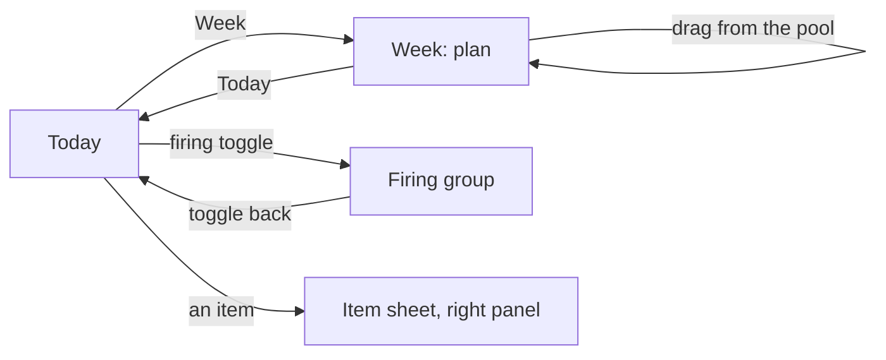

# Part 6: work at a desk

Parts 1 to 5 are the phone. This part is the same day at a desk: a MacBook at 1728 × 1117, light first. "Iteration 3" and "round n" point to [Taylor's notes of 2026-10-10](../../../../../../docs/product/operator-notes/2026-10-10-workflow-at-a-desk.md) and the interview logged there. It bends N1's "there is no desktop", as D-USE-39 already did; parts 1 to 5 are not edited.

## The moment and the feeling

It's mid-morning on a workday. Taylor is at the desk with two or three AI threads running for two or three clients. A prompt has just gone out, and there are a few minutes to wait. The question is always the same: what's mine to do right now, while that runs?

The desk should answer it at a glance, today first: the day's Primary, Secondary and Stretch work, the to-dos, and what's firing (round 2, answer 7). The week is one click away for planning, and the rest of the pipeline stays out of sight until it's asked for. It must never become a board to manage: "a useless layer of noise" is what iteration 2 warned against.

## Words this part adds

- **Firing.** A work item waiting on AI, set by hand with one tap. It shows a breathing mark and how long it has been firing, as a length ("firing · 4 min"). It never writes to Linear (rounds 2 and 3). It is kept from the Workflow board (FLO), without any hook into Claude Code (iteration 3).
- **Client.** Optional and off by default. A client is a name and a colour. A Linear workspace can be connected to a client, so all its projects belong to it, or a single project can be set to a client. Taylor's own central workspace holds projects for several clients and for none (round 2, answer 5).
- **Session.** One day's share of a task that takes more than one day. The task is one item, placed on several days. Checking a session means "done for today". The task is done when Taylor marks it done, or when Linear does (round 1).
- **Sub-issue.** A checkable row inside its issue, synced with Linear. It can also be placed on a day by itself (round 4).
- **Pool.** Work saved and not yet on a day (D-USE-31). At the desk it is the pipeline, for now (round 3).

## A day in the life

At 9:30, the Work block begins. Taylor opens Synapse on the Mac and it opens on **Today**. Down the middle are the day's tiers: one Urgent, two Primary, three Secondary and Stretch, with the to-dos below them. On the right is a narrow column with the whole day: the 11:00 client call in plum, lunch, and the stretch break.

The first Primary is lifted, with Start and Done. Taylor writes a prompt and taps the firing toggle on that item. It moves to a **Firing** group at the top, breathing, and the next Primary lifts. A quiet line under the Firing group reads "While it fires: Kegels", because the daily Kegels reminder hasn't been done yet. Taylor checks Kegels. Four minutes later the first thread finishes, and Taylor taps the toggle again. The item returns to its tier, with "back · 1 min".

At 15:00 the stretch break shows as a band at the top of Today: "Stretch break · 15:00 to 15:10". Its push notification arrived on the Mac.

On Sunday evening, Taylor clicks **Week**. Seven day columns show each day's work tiers and the week's events. On the left is the pool, with From Linear as a tab, and a client filter that reads All, then each client. Taylor drags a Large issue onto Tuesday's Primary and again onto Wednesday's: two sessions. A sub-issue goes on Thursday's Secondary by itself. Each day's foot says where its work ends, at the top of the ranges. Then Taylor clicks Today again.

## Surfaces

### The rail

**What you see.** D-USE-39's rail, holding **Today**, **Week**, **Schedule** and, below a rule, "Workflow (beta)" until the board retires. The avatar sits in the footer. On the phone the tabs stay as they are.

### Today, at the desk

**What you see**, left to right after the rail:

- **The main column**, capped and centred:
  - The header: "Monday, 12 October", and the current block as a slim band while it's on ("Lunch · 12:00 to 13:00").
  - **Firing**, only when something is firing. Each row has its breathing mark, its title, "firing · 4 min" and the toggle.
  - The tiers: **Urgent** (only when it holds something), **Primary**, **Secondary**, **Stretch**. Each is a `GroupHeading` with its colour square (D-USE-38). Each row shows a toggle, an `ItemIcon`, the title, a `LinearLine` (client mark and name, project, "KES-42", status shape and word), and the size word and length ("3 Medium · 1 to 2 h"). Sub-issues fold under their issue. The first undone Primary is lifted as a card with **Start** and **Done**. Done is the primary action.
  - **To-dos**, as an open section, not a tray: the daily reminders and the day's to-dos.
- **The day column**, narrow, on the right: the phone's Schedule at a smaller scale, with the `NowLine` and events in plum. Clicking a block opens its Block view in the right panel.

**What you do.** Use the firing toggle (one tap, on work items only), Start, Done, check a box, drag between tiers, and click a row to open the Item sheet in `ResponsiveSheet`'s right panel. A session's Done reads "Done for today". "Mark the task done" is in its menu.

**Why it matters.** It is the phone's go mode with enough width to see everything Taylor juggles. It bends N4's "only the active block" at the desk, by Taylor's choice (round 3, answer 9).

| State             | What the person sees                                                           |
| ----------------- | ------------------------------------------------------------------------------ |
| before Ready, go  | The day as Review the day would show it, with Ready, go at the column's foot   |
| nothing firing    | No Firing group                                                                |
| everything firing | Firing holds every work item, the tiers show "All firing." and the to-dos lift |
| not a work block  | The band on top names the block; the tiers stay, quieter                       |
| no work slotted   | Each tier has "Add to Primary" and the others; a line points to Week           |
| loading, error    | Skeleton rows; `RegionRetry` "Today didn't load."                              |
| offline           | Everything works; Linear changes wait; a `StatusLine` says so                  |
| Linear failed     | "Not updated in Linear." with Try again, in ink (D-USE step 8)                 |

### Firing, in detail

The toggle is FLO's: a 10 px ring, or when firing, the accent mark breathing (FLO §3.3). When an item fires it leaves its tier for the Firing group, and the next undone item in the tier lifts. When it is toggled back it returns to its tier and place, with "back · 1 min" for a while. The time is shown in minutes, never seconds. [ASSUMPTION: firing ends at the day's close like a running timer, and the item stays where it was.] The daily reminder line shows only while something fires and a daily reminder is undone. It names one reminder and never counts.

### Week (Plan week)

**What you see.** The same data as Set my days › This week (N2), in a desk layout:

- The pool panel on the left, with `Tabs` "Pool" and "From Linear". It has a client `Select` (All, then each client; not shown when clients are off), a size filter and a search.
- Seven day columns, "Mon 12" to "Sun 18", with "‹ 12 to 18 Oct ›". Each day shows its events in plum, then its tiers as compact rows, then a fit line: "Work ends 17:40 at the top of the ranges", or "Doesn't fit by 40 min". Those are lengths and times, never counts.

**What you do.** Drag from the pool to a day's tier. Drag the same issue to another day to add a session. The item then shows "Session 2 of the task" [PROPOSED: wording to Gloss] and a small link mark. You can drag between days and click an item for its sheet. The client filter narrows the pool only, never the days (round 2, answer 6).

| State          | What the person sees                                               |
| -------------- | ------------------------------------------------------------------ |
| empty week     | The usual week's blocks, with empty tiers; the pool is full        |
| Linear not set | The From Linear tab reads "Connect Linear" and goes to Connections |
| one workspace  | No workspace grouping (D-USE-31)                                   |
| a past day     | Shown faded and still editable, nothing marked missed              |

### Connections (Settings)

Linear workspaces, each connected on its own. A "Clients" switch, off by default. When it's on, there is a list of clients, and each workspace row has "All projects belong to [client]" or "Set per project". Google calendars are read-only, several of them, each on or off (the Google Calendar dev note). Calendars and desktop push are not part of the two days (round 4); they are drawn, and wired after.

### The phone

The phone keeps the whole USE day as designed. For work, it also adds and edits items, tiers, firing, sub-issues and This week. The two-pane Week and the pipeline are desk-only (round 4).

## What Paper will hold

A new page, "USE — work", in file `01M49AX02VV4SSBKNCN6NRTS6Y`. Artboards are 1728 × 1117, light only, named `<surface> / <state> / 1728 / light`. The bands have row labels at x -560 and a note under each frame. The clients are invented: Kestrel Health [placeholder], Alder Studio [placeholder], and Personal.

- **Variations: yes.** Three directions, each a different answer to "today first, week in reach":
  - **A, Today plus a week strip:** Today as described above, with a seven-day strip across the top. Clicking a day previews it in place. Week is its own view.
  - **B, The accordion week:** Today is a wide column and the other six days are narrow columns beside it, in one canvas. Clicking a day widens it; Week makes them all equal and opens the pool.
  - **C, Today plus a planner page:** Today on the left two-thirds, and the week as a vertical list of days on the right, like the Passion Planner's week page. The pool slides over it to plan.
  - Each direction shows Today (one item firing), and its Week with the pool open.
- **Pace:** all three at once, then the chosen one is pushed until lock.

## Open questions

- [NEEDS DECISION] Keyboard at the desk (Done, Start, firing, next item). Default: F toggles firing on the focused row, D is Done, J and K move.
- [NEEDS DECISION] The FLO board's tables and code (groups, views, columns, templates, tasks with firing). Default: keep them behind "Workflow (beta)" until the pipeline is designed, move firing onto items, then retire them. This goes to Mason.
- [NEEDS DECISION] When a whole-pipeline view comes, and its shape (the round 2 options: columns by status group, or a list). Default: after the two days.
- [NEEDS DECISION] Push for an event's start (10 minutes before). Default: off, and on per calendar.
- [ASSUMPTION] Iteration 2's "Evening tasks" toggle and label colours wait for a later round.
- Bends, named: the desk Today shows more than the active block (N4, note 56). Firing's minutes are a length, never a count. The client mark carries its name, so colour is never alone.
